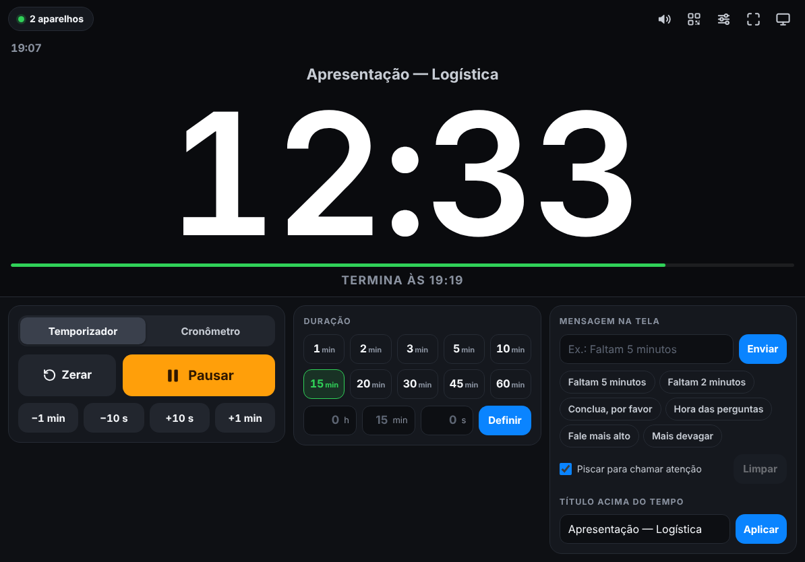
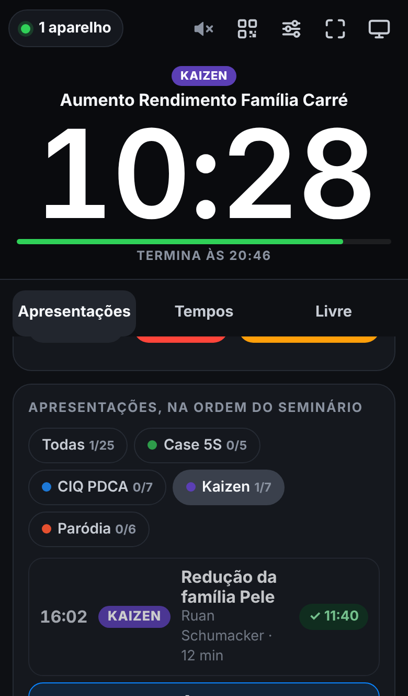

# ⏱️ Cronômetro Sync

Cronômetro e temporizador para apresentações que você controla de **vários aparelhos ao mesmo tempo**: deixe o tempo aberto no iPad e inicie, pause, zere ou some tempo pelo iPhone, pelo PC ou pelo próprio iPad. Toda mudança aparece na hora em todas as telas.

<p align="center">
  
  &nbsp;
  
</p>

## Duas formas de usar

| | **A. Pela internet** (recomendada) | **B. Pela rede local** |
|---|---|---|
| Precisa instalar algo no PC? | **Não.** Só um navegador. | Sim: Node.js e um programa que fica aberto. |
| Funciona em PC de empresa? | Sim (só precisa abrir um site). | Em geral não (instalação e Firewall pedem administrador). |
| Precisa de internet? | Sim, nos aparelhos. | Não, só do mesmo Wi-Fi. |
| Os aparelhos precisam estar na mesma rede? | **Não**: o iPhone pode estar no 4G. | Sim. |
| Como configurar | Seções 1 a 4 abaixo (uns 15 minutos, uma vez). | Seção "B" mais abaixo. |

---

# A. Pela internet (sem instalar nada)

O tempo fica guardado num banco de dados gratuito do **Firebase** (Google). O site do cronômetro fica hospedado de graça no **GitHub Pages**. Cada apresentação usa uma **sala** (um código de 8 letras e números): quem estiver na mesma sala vê e controla o mesmo tempo.

## 1. Criar o banco de dados no Firebase

1. Entre em <https://console.firebase.google.com> com sua conta Google e crie um projeto (por exemplo, **CRONOMETRO**). Pode desligar o Google Analytics.
2. No menu da esquerda, abra **Realtime Database** e clique em **Criar banco de dados**.
3. **Local:** deixe o padrão (Estados Unidos). **Regras de segurança:** escolha **Iniciar no modo bloqueado** e clique em **Ativar**.
4. Abra a aba **Regras**, **apague tudo** o que estiver lá, cole o texto abaixo e clique em **Publicar**:

```json
{
  "rules": {
    ".read": false,
    ".write": false,
    "salas": {
      "$sala": {
        ".read": "$sala.matches(/^[A-Z0-9]{8}$/)",
        ".write": "$sala.matches(/^[A-Z0-9]{8}$/)",
        "estado": {
          ".validate": "newData.hasChildren(['rev', 'mode', 'timer', 'stopwatch', 'settings', 'message'])",
          "v": { ".validate": "newData.isNumber()" },
          "rev": { ".validate": "newData.isNumber()" },
          "mode": { ".validate": "newData.val() === 'timer' || newData.val() === 'stopwatch'" },
          "title": { ".validate": "newData.isString() && newData.val().length <= 160" },
          "timer": {
            ".validate": "newData.hasChildren(['base', 'duration', 'elapsed'])",
            "base": { ".validate": "newData.isNumber()" },
            "duration": { ".validate": "newData.isNumber()" },
            "elapsed": { ".validate": "newData.isNumber()" },
            "startedAt": { ".validate": "newData.isNumber()" },
            "$other": { ".validate": false }
          },
          "stopwatch": {
            ".validate": "newData.hasChild('elapsed')",
            "elapsed": { ".validate": "newData.isNumber()" },
            "startedAt": { ".validate": "newData.isNumber()" },
            "laps": {
              "$i": { ".validate": "$i.matches(/^[0-9]{1,2}$/) && newData.isNumber()" }
            },
            "$other": { ".validate": false }
          },
          "settings": {
            ".validate": "newData.hasChildren(['warnAt', 'dangerAt', 'overtime'])",
            "warnAt": { ".validate": "newData.isNumber()" },
            "dangerAt": { ".validate": "newData.isNumber()" },
            "overtime": { ".validate": "newData.isBoolean()" },
            "$other": { ".validate": false }
          },
          "message": {
            ".validate": "newData.hasChildren(['text', 'flash', 'id'])",
            "text": { ".validate": "newData.isString() && newData.val().length <= 280" },
            "flash": { ".validate": "newData.isBoolean()" },
            "id": { ".validate": "newData.isNumber()" },
            "until": { ".validate": "newData.isNumber()" },
            "$other": { ".validate": false }
          },
          "agenda": {
            "current": { ".validate": "newData.isString() && newData.val().length <= 24" },
            "sent": {
              "half": { ".validate": "newData.isBoolean()" },
              "last": { ".validate": "newData.isBoolean()" },
              "$other": { ".validate": false }
            },
            "results": {
              "$id": {
                ".validate": "$id.matches(/^[a-z0-9-]{1,24}$/) && newData.hasChildren(['used', 'allowed', 'points'])",
                "used": { ".validate": "newData.isNumber()" },
                "allowed": { ".validate": "newData.isNumber()" },
                "points": { ".validate": "newData.isNumber()" },
                "at": { ".validate": "newData.isNumber()" },
                "by": { ".validate": "newData.isString() && newData.val().length <= 80" },
                "$other": { ".validate": false }
              }
            },
            "$other": { ".validate": false }
          },
          "last": {
            "type": { ".validate": "newData.isString() && newData.val().length <= 20" },
            "target": { ".validate": "newData.isString() && newData.val().length <= 20" },
            "ms": { ".validate": "newData.isNumber()" },
            "at": { ".validate": "newData.isNumber()" },
            "by": {
              "id": { ".validate": "newData.isString() && newData.val().length <= 128" },
              "name": { ".validate": "newData.isString() && newData.val().length <= 80" },
              "$other": { ".validate": false }
            },
            "$other": { ".validate": false }
          },
          "$other": { ".validate": false }
        },
        "aparelhos": {
          "$id": {
            ".validate": "$id.length <= 128 && newData.hasChild('nome')",
            "nome": { ".validate": "newData.isString() && newData.val().length <= 80" },
            "desde": { ".validate": "newData.isNumber()" },
            "$other": { ".validate": false }
          }
        },
        "$other": { ".validate": false }
      }
    }
  }
}
```

   Essas regras só permitem salas com código de 8 letras e números e só aceitam dados no formato do cronômetro. Ninguém consegue listar as salas existentes.
5. Abra a aba **Dados** e **copie o endereço** que aparece no alto. Ele se parece com `https://cronometro-73d5c-default-rtdb.firebaseio.com`. Guarde: você vai colar no passo 4.

> Os nomes dos botões do Firebase mudam de vez em quando. Se algo estiver com outro nome, procure o equivalente. O plano gratuito (**Spark**, "sem custos") é mais que suficiente para isso.

## 2. Colocar o site no ar (GitHub Pages)

1. **Descompacte** o arquivo ZIP do cronômetro no computador.
2. No seu repositório do GitHub, clique em **Add file → Upload files**, arraste a **pasta `cronometro` inteira** para a página e clique em **Commit changes**.
3. Ainda no repositório, vá em **Settings → Pages**. Em **Build and deployment**, escolha **Deploy from a branch**, branch **main**, pasta **/ (root)**, e clique em **Save**. (Se o Pages já estiver ligado, não precisa mexer.)
4. Espere 1 a 2 minutos. O cronômetro fica em:

   **`https://SEU-USUARIO.github.io/NOME-DO-REPOSITORIO/cronometro/`**

   (com o seu usuário e o nome do repositório do GitHub).

> **Alternativa sem GitHub:** em <https://app.netlify.com/drop>, arraste a pasta `cronometro/public` e o Netlify dá um endereço na hora (pode pedir para criar uma conta gratuita para o endereço não expirar).

## 3. Testar a conexão (2 minutos)

Faça isso **no PC da empresa e no iPad**, que são os que podem ter rede mais restrita:

1. Abra `https://SEU-USUARIO.github.io/NOME-DO-REPOSITORIO/cronometro/public/teste.html`.
2. Cole o endereço do Firebase (passo 1.5) e clique em **Testar**.
3. Todos os itens devem ficar com ✓. Se algum ficar com ✕, a página diz o que fazer (por exemplo, colar as regras de novo, ou que a rede bloqueia o Firebase).

## 4. Usar

1. **No iPad** (a tela do tempo): abra o endereço do cronômetro. Na primeira vez ele pede o **endereço do Firebase**: cole, toque em **Criar uma sala nova**. Pronto.
2. Toque no botão de **QR code** (no alto). Aparecem o QR code, o link e o **código da sala** (como `K7M2-Q9XR`).
3. **No iPhone:** abra a **Câmera**, aponte para o QR code e toque no link. Ele entra na sala sozinho, sem pedir nada.
4. **No PC:** use **Copiar** para mandar o link para você mesmo (WhatsApp Web, e-mail) e abra no PC. Ou abra o site e digite o código em **Entrar numa sala que já existe**. Para digitar só o código, o endereço do Firebase precisa já estar no site: veja "Deixar tudo pré-configurado" abaixo.
5. O alto da tela mostra quantos aparelhos estão na sala. Qualquer um controla.

**Nas próximas vezes:** o iPad lembra da sala. Basta abrir o site (ou o ícone na tela de início). Para uma apresentação nova, use **Trocar de sala** no botão de QR code.

### Deixar tudo pré-configurado

Esta versão já vem configurada com o banco `cronometro-73d5c`. Se você usar outro banco, ou para ninguém precisar colar o endereço do Firebase, abra o arquivo `cronometro/public/firebase-config.js` no GitHub (ícone de lápis), coloque o endereço entre as aspas de `databaseURL: ""` e salve (**Commit changes**). Aí o PC só precisa do site e do código da sala.

### Dicas para o iPad

| Quero… | Como |
|---|---|
| Tela cheia, como um app | No Safari: **Compartilhar → Adicionar à Tela de Início**. Depois abra pelo ícone. |
| Que a tela não apague | **Ajustes → Tela e Brilho → Bloqueio Automático → Nunca** |
| Só o tempo, sem botões | Botão de **monitor** no topo (ou tecla **E**). Para voltar, toque no **×** no canto. |
| Ouvir o alarme | Toque uma vez em qualquer lugar da tela: o iPad só libera o som depois de um toque. |

Precisa de iPad/iPhone com iOS ou iPadOS 14 ou mais novo.

## O que dá para fazer

**Temporizador** (contagem regressiva)
- Tempos rápidos de 1 a 60 minutos ou qualquer tempo (horas, minutos e segundos).
- **−1 min, −10 s, +10 s, +1 min** a qualquer momento, inclusive com o tempo correndo.
- Fica **amarelo** e depois **vermelho** quando está acabando (você escolhe quando, em Ajustes).
- No zero: tela vermelha piscando e alarme. Continua contando o tempo excedido (−00:35) — ou para no zero, se preferir.
- Mostra a hora em que vai terminar (“Termina às 14:45”).

**Cronômetro**: iniciar, pausar e marcar voltas, com a volta mais rápida em verde e a mais lenta em vermelho.

**Mensagem na tela**: mande um aviso para quem está apresentando (“Faltam 5 minutos”, “Conclua, por favor”…), que pode piscar para chamar atenção.

**Título**: nome da apresentação ou de quem está falando, acima do tempo.

Cada aparelho liga ou desliga o próprio som, sem mexer nos outros. Quando alguém muda algo, os outros aparelhos mostram um aviso como “Temporizador pausado por iPhone”.

### Atalhos de teclado (PC)

| Tecla | Ação |
|---|---|
| Espaço | Iniciar / pausar |
| R | Zerar |
| V | Marcar volta |
| T / C | Temporizador / cronômetro |
| ↑ ↓ | +1 / −1 minuto |
| → ← | +10 / −10 segundos |
| E | Modo exibição (só o tempo) |
| F | Tela cheia |
| M | Liga / desliga o som |

## Modo seminário: apresentações, tempos e penalidades

A aba **Apresentações** traz a programação do seminário (arquivo `public/programacao.js`), na ordem do papel, com as categorias **Case 5S** (8 minutos), **CIQ PDCA** (12 minutos) e **Kaizen** (12 minutos). A **Paródia** é vídeo: aparece apagada na lista, para marcar a ordem, mas não tem cronômetro, nem pontos, nem entra na aba Tempos.

**Quem cuida do tempo:**
1. Toque numa categoria (ou em **Todas**) para ver só aquelas apresentações, sempre na ordem do seminário.
2. Toque na apresentação. O nome, a categoria, o líder e o tempo dela aparecem em **todas** as telas, e o relógio já fica no tempo certo.
3. **Iniciar**. Dá para **Pausar** e **Continuar** quantas vezes precisar.
4. **Parar** (ou a tecla **P**) encerra e **registra** o tempo usado. Só o Parar registra.
5. Aparece o botão **Próxima: …**, que já escolhe a seguinte da fila.

**Mensagens automáticas:** em todas as telas aparece, em amarelo e piscando, **"Metade do tempo: faltam N minutos"** quando passa a metade (4 min no Case 5S, 6 min no CIQ PDCA e no Kaizen) e **"Falta 1 minuto"** quando falta 1 minuto. Cada uma aparece uma vez por apresentação e some sozinha depois de uns 12 segundos. As mensagens que você digita continuam até limpar.

**Pontos:** cada minuto **completo** acima do tempo custa **1 ponto**. Até 59 segundos acima, não perde nada. Passou de −01:00, são 1 ponto; de −02:00, 2 pontos; e assim por diante. Enquanto o tempo estoura, a tela já mostra "Penalidade: −N pontos".

**Erros e correções:**
- Parou sem querer? Toque em **Desfazer a parada**: o tempo volta pausado de onde estava, e dá para **Continuar**.
- **Zerar** limpa o relógio sem registrar (pede confirmação).
- Escolher outra apresentação com uma em andamento pergunta antes, e o tempo da que ficou para trás **não** é registrado.
- Escolher uma que já tem tempo pergunta se quer refazer.

**Aba Tempos:** todas as apresentações com o tempo limite, o tempo usado, o excesso, os pontos perdidos e a situação (Pendente, Em andamento, Sem penalização ou Com penalização). Dá para filtrar por categoria, apagar um tempo (×), **Copiar para Excel**, **Baixar CSV** (abre direto no Excel) e **Limpar todos os tempos** (use depois do ensaio, antes do evento).

Os tempos ficam guardados na sala (no Firebase, ou no servidor local). Qualquer aparelho vê a mesma tabela, e ela continua lá se você recarregar a página.

**Para mudar nomes, tempos ou a ordem**, edite `cronometro/public/programacao.js` (no GitHub: abra o arquivo, ícone de lápis, **Commit changes**). Os tempos padrão (`min`) ficam em cada categoria; para uma apresentação ter um tempo diferente, ponha `min: 10` (em minutos) nela. Se você mudar a regra de pontos, ela está em `public/core.js` (`PENALTY_MS` e `PENALTY_POINTS`).

**A aba Livre** é o cronômetro/temporizador comum, sem programação. Escolher um tempo livre tira o nome da apresentação das telas.

> **Se você já tinha colado as regras do Firebase antes desta versão:** cole de novo a versão nova (seção 1.4) e clique em **Publicar**. Sem isso, o Firebase recusa o registro dos tempos e as mensagens automáticas.

## Problemas comuns (pela internet)

**A página de teste mostra ✕ em "Conexão com o Firebase"**: a rede pode estar bloqueando `*.firebaseio.com` (ou `*.firebasedatabase.app`). Teste no 4G do celular. Se funcionar lá, peça ao TI da empresa para liberar esses endereços.

**"O Firebase recusou: confira as regras de segurança"**: as regras do passo 1.4 não foram coladas ou publicadas. Cole de novo na aba **Regras** e clique em **Publicar**.

**Aparece "Reconectando…" no topo**: o aparelho ficou sem internet. Ele volta sozinho, com o tempo certo.

**O PC mostra a tela "Sincronizar pela internet" toda vez**: o navegador está apagando os dados do site ao fechar. Use o link da sala (ele traz tudo) ou deixe o endereço pré-configurado.

**Entrei na sala errada**: use **Trocar de sala** no botão de QR code.

**As telas viram o segundo com diferença de décimos de segundo**: normal. Cada aparelho estima o relógio do servidor pela internet, e a diferença costuma ficar abaixo de meio segundo.

## Segurança e privacidade

- O que vai para o Firebase são só os números do cronômetro, o título e as mensagens que você digitar, e o nome dos aparelhos conectados.
- **Quem tiver o código ou o link da sala controla o cronômetro.** Os códigos têm cerca de 10¹² combinações e as regras impedem listar as salas, então não dá para "descobrir" uma sala. Para encerrar o acesso de todos, crie uma sala nova.
- O endereço do Firebase não é segredo (ele aparece no código do site); quem protege os dados são as regras do passo 1.4.

---

# B. Pela rede local (com um programa no computador)

Use quando não houver internet, ou se você tiver um computador onde possa instalar o Node.js. Em PC de empresa, em geral não funciona: prefira a opção A.

O computador roda um programinha que guarda o tempo. Os outros aparelhos abrem o endereço dele no navegador, na mesma rede Wi-Fi.

### Primeira vez (uns 5 minutos)

1. **Instale o Node.js** no computador: entre em <https://nodejs.org>, baixe a versão **LTS** e instale (Avançar, Avançar…).
2. **Baixe esta pasta**: na página do repositório no GitHub, botão verde **Code → Download ZIP**. **Descompacte** o arquivo.
3. Abra a pasta `cronometro`.

### Toda vez que for usar

1. No computador, dê dois cliques em:
   - **Windows:** `INICIAR-WINDOWS.bat`
   - **Mac:** `INICIAR-MAC.command`

   Na primeira vez, o computador pode pedir permissões:
   - **Windows:** no aviso do Firewall, marque **Redes privadas** e clique em **Permitir acesso**.
   - **Mac:** se disser que o arquivo é de um desenvolvedor não identificado, vá em **Ajustes do Sistema → Privacidade e Segurança → Abrir Mesmo Assim**. Se perguntar se o “node” pode aceitar conexões, clique em **Permitir**.
2. Abre uma janela com o endereço (por exemplo `http://192.168.0.15:3000`) e um **QR code**. O cronômetro também abre no navegador do PC.
3. No **iPad** e no **iPhone**, conectados ao **mesmo Wi-Fi** do computador: abra a **Câmera**, aponte para o QR code e toque no link — ou digite o endereço no Safari.
   No app, o botão de **QR code** no topo mostra o código e o endereço de novo.
4. Pronto: qualquer aparelho controla. O topo de cada tela mostra quantos aparelhos estão conectados.

Deixe a janela do programa aberta enquanto estiver usando. Para encerrar, feche a janela.

As dicas para o iPad (tela cheia, tela sempre ligada, modo exibição, som) são as mesmas da opção A, acima. Funcionalidades e atalhos de teclado também.

### Problemas comuns (rede local)

**O iPhone ou o iPad não abre o endereço**
- Confira se estão no **mesmo Wi-Fi** do computador (e não no 4G/5G).
- Se o navegador pedir permissão para **acessar a rede local**, toque em **Permitir**. No iPhone/iPad com Chrome: *Ajustes → Chrome → ative Rede Local*.
- **Windows:** se você clicou em Cancelar no aviso do Firewall, abra *Painel de Controle → Sistema e Segurança → Firewall do Windows Defender → Permitir um aplicativo* e marque **Node.js** em **Privada** (e em **Pública**, se a sua rede estiver como pública).
- Tente os outros endereços que a janela do programa mostra.
- Redes de empresas, hotéis e eventos às vezes bloqueiam a comunicação entre aparelhos. Solução: ligue o **Acesso Pessoal** (hotspot) do iPhone e conecte nele o computador e o iPad.

**Aparece “Reconectando…” no topo**: o aparelho perdeu contato com o computador (o Wi-Fi caiu, a janela do programa foi fechada ou o computador entrou em repouso). Ele volta sozinho quando a conexão voltar, com o tempo certo.

**A porta 3000 já está em uso**: o programa escolhe outra sozinho (3001, 3002…) e mostra o endereço certo.

**O arquivo de clique duplo não funciona**: abra o Terminal (Mac) ou o Prompt de Comando (Windows) dentro da pasta `cronometro` e digite:

```
node server.js --abrir
```

Opções: `--porta=8080` escolhe a porta; `--sem-qr` não desenha o QR code na janela.

### Segurança (rede local)

- Tudo fica no seu computador e na sua rede: nada vai para a internet.
- Qualquer pessoa conectada à **mesma rede** que souber o endereço consegue abrir o cronômetro. Em redes públicas, prefira o hotspot do celular.

### Sem computador nenhum?

Abrir `public/index.html` direto no navegador funciona como cronômetro de **um aparelho só**, sem sincronizar (o topo mostra "Sem servidor").

## Para desenvolvedores

- `public/` é o site (HTML/CSS/JS puros, sem build). Publique essa pasta em qualquer hospedagem estática.
- `public/core.js`: a lógica do temporizador e do cronômetro, a mesma no servidor local e no navegador.
- `public/cloud.js`: modo nuvem. Sala, link e conexão com o Firebase Realtime Database (SDK `compat` incluído em `public/vendor/`, carregado só quando preciso). Cada comando é uma *transaction* sobre `salas/<código>/estado`; a presença dos aparelhos fica em `salas/<código>/aparelhos`.
- `public/app.js`: a interface. Detecta sozinho o modo: servidor local (`/api/info`), nuvem, ou só neste aparelho.
- `server.js`: servidor HTTP sem dependências (Node.js 16+), com Server-Sent Events, para o modo local.
- `firebase-rules.json`: regras de segurança do banco.
- Testes: `npm test`. Os testes das regras (`test/rules.test.js`) precisam do emulador do Firebase (Java instalado): `npx firebase-tools emulators:exec --only database --project demo-cronometro "node --test test/rules.test.js"`.
- Bibliotecas de terceiros em `public/vendor/` (licenças em `LICENSES.txt`): Firebase JS SDK 12.17.1 (Apache-2.0) e qrcode-generator (MIT).
